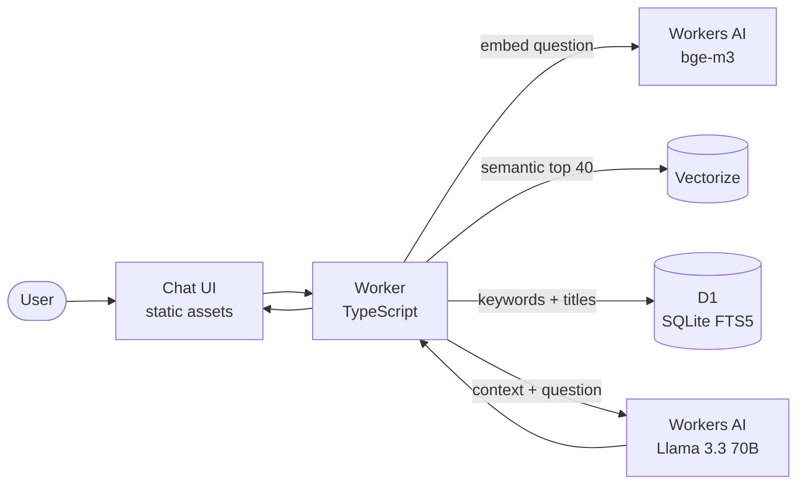

# RAG Catalog — recommendation chatbot on Cloudflare's free tier

A chatbot that **recommends and answers questions** about a personal catalog of
movies, TV series, books, music, video games and documentaries. It is a
Retrieval-Augmented Generation (RAG) system that runs entirely on Cloudflare's
free plan: no servers, no database to operate, no API key required, and it is
deployed automatically on every push.

**Live demo:** https://rag-catalog.mgutierrezt.workers.dev

[](https://github.com/manu-gt-hub/rag_system/actions/workflows/ci.yml)
[](https://github.com/manu-gt-hub/rag_system/actions/workflows/deploy.yml)
[](https://github.com/manu-gt-hub/rag_system/actions/workflows/monitor.yml)

Try: *Recommend me a horror movie* → *any more recent ones?* · *What do I have by
Danny Boyle?* · *An RPG for the Game Boy* · *A science fiction book to read*

## How it works



1. **Indexing** (build time): 17,310 catalog records become ~2,400 semantic
   documents (series grouped per show, music per album, duplicates merged),
   embedded with the multilingual `bge-m3` model and loaded into Vectorize and D1.
2. **Hybrid retrieval**: vector similarity (meaning) and full-text search
   (exact names, titles) run in parallel and are fused with Reciprocal Rank
   Fusion.
3. **Generation**: an LLM writes the recommendation using only the retrieved
   documents, in the language of the question.

Architecture, diagrams and technology choices: [doc/architecture.md](doc/architecture.md).

## Quality is measured, not assumed

Every deploy runs a battery of questions against the live demo and scores it
with the rubrics in [doc/rubrics.md](doc/rubrics.md) (retrieval relevance,
answer precision, completeness, format). The scores are shown in the summary
of each [Deploy run](https://github.com/manu-gt-hub/rag_system/actions/workflows/deploy.yml),
the full report is attached to it, and the job fails if the thresholds are not met.

## Deploy your own (free)

Requirements: Node 22+ and a free Cloudflare account.

```bash
git clone <repo> && cd rag_system
npm install
npx wrangler login            # or put CLOUDFLARE_ACCOUNT_ID / CLOUDFLARE_API_TOKEN in .env
cp .env.example .env          # needed by `npm run index` (embeddings via the REST API)

npm run setup                 # creates D1 + Vectorize, writes the D1 id into wrangler.jsonc
npm run index                 # builds, embeds and loads the catalog (~2 min)
npm run deploy                # prints https://rag-catalog.<subdomain>.workers.dev
```

### Continuous deployment

Add two repository secrets (Settings → Secrets and variables → Actions):
`CLOUDFLARE_API_TOKEN` (permissions: Workers Scripts Edit, D1 Edit, Vectorize
Edit, Workers AI Read) and `CLOUDFLARE_ACCOUNT_ID`. Commit the `database_id`
written by `npm run setup`. From then on every push to `main`:

| Step | What happens |
|---|---|
| Test | Typecheck + tests (retrieval on the real catalog in SQLite, chat UI in happy-dom) + Worker build, no account needed |
| Index | Re-embeds and reloads **only if** the catalog, document format or model changed |
| Deploy | `wrangler deploy` |
| Smoke test | `/health` and a retrieval query against the live URL |
| Evaluate | Rubric evaluation on the live demo, report as artifact |

Set the repository variable `DEMO_URL` to enable the 6-hourly health check
(`monitor.yml`).

### Free tier budget

| Resource | Free allowance | Usage |
|---|---|---|
| Workers | 100,000 requests/day, 10 ms CPU/request | the Worker only orchestrates I/O |
| Vectorize | 5 M stored / 30 M queried dimensions per month | 2.5 M stored, ~26,000 questions/month |
| Workers AI | 10,000 Neurons/day | ~120 per answer → **~70 answers/day**; retrieval-only checks are almost free |
| D1 | 5 GB | ~7 MB |

Nothing is ever billed: when the daily AI allocation runs out the API answers
with a clear message until the next day. A rate limit (10 questions/minute per
IP) protects the quota.

### Better answers with OpenAI or Anthropic (optional)

```bash
npx wrangler secret put OPENAI_API_KEY        # or ANTHROPIC_API_KEY
# wrangler.jsonc: "LLM_PROVIDER": "openai"   (or "anthropic")
npm run deploy
```

Retrieval keeps using Vectorize and `bge-m3`, so no re-indexing is needed.

## API

| Endpoint | Body | Description |
|---|---|---|
| `POST /api/chat` | `{"message", "history": [{"role","content"}], "category"?, "lang"?}` | Chat with conversational memory |
| `POST /api/query` | `{"question", "category"?, "top_k"?, "lang"?}` | Single question |
| `POST /api/search` | `{"question", "category"?, "top_k"?}` | Retrieval only (no LLM) |
| `GET /api/config` | — | Model and category labels |
| `GET /health` | — | Liveness |

`category`: `peliculas` (movies), `libros` (books), `series`, `musica` (music),
`videojuegos` (video games), `documentales` (documentaries); inferred from the
question when it names exactly one.

`lang` (`en` default, `es`) is the language of the UI: it only affects
server-written text such as the "nothing found" answer. The LLM always replies
in the language of the question. Errors include a stable `code`
(`rate_limited`, `quota_exceeded`, `missing_question`, `unknown_category`,
`message_too_long`, `internal_error`) so clients can show their own messages.

The chat UI is available in English and Spanish (switcher in the header,
English by default).

## Development

```bash
npm test             # builds the catalog SQL, runs all tests (no account needed)
npm run typecheck
npm run dev          # local Worker using the remote AI, Vectorize and D1
npm run evaluate -- --url https://rag-catalog.<subdomain>.workers.dev
```

## Project structure

```
├── src/                 Worker (runs on Cloudflare)
│   ├── index.ts         API routes + RAG pipeline
│   ├── retriever.ts     hybrid search: Vectorize + D1 FTS5, RRF fusion
│   ├── generator.ts     Workers AI / OpenAI / Anthropic
│   ├── prompt.ts        system prompt
│   └── text.ts          normalization, query terms, category detection
├── indexer/             catalog JSON → documents → embeddings → Vectorize + D1
├── evaluation/          question battery, rubrics, evaluator
├── scripts/             setup (resources) and wrangler helper
├── public/index.html    chat UI
├── schema.sql           D1 schema
├── test/                vitest suites (indexer, retrieval, API, rubrics, UI)
├── resources/indexes/   catalog data (JSON per category)
├── doc/                 architecture and rubrics
└── .github/workflows/   ci, deploy, monitor
```
