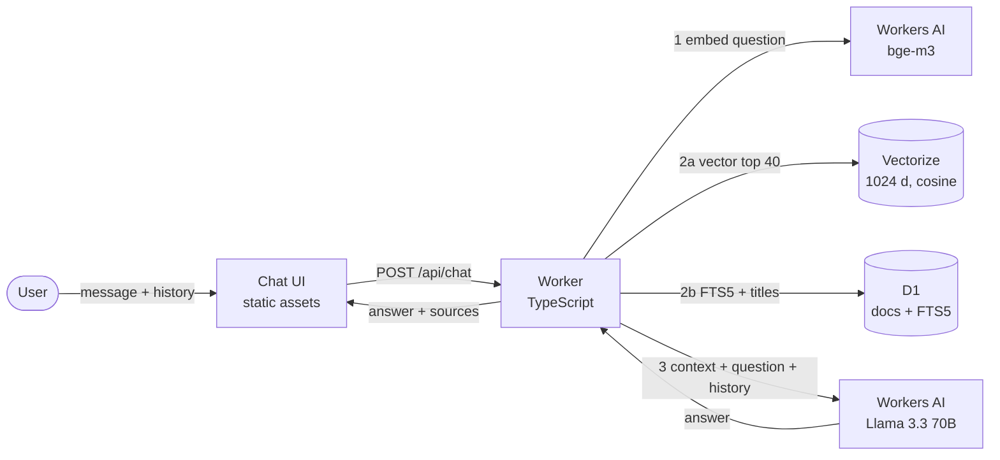
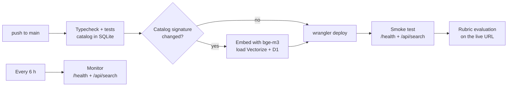
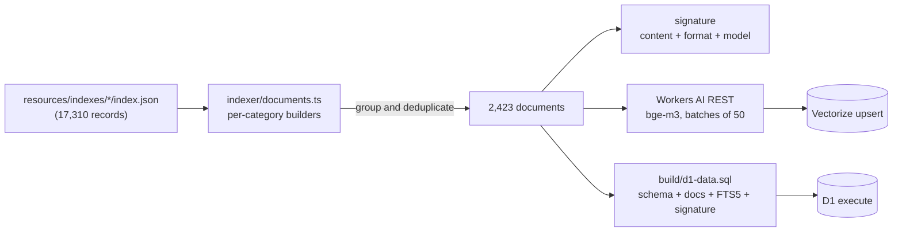
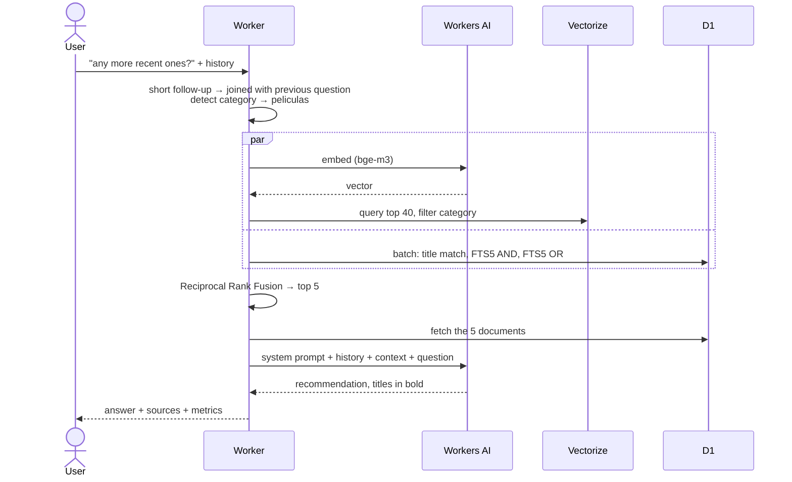
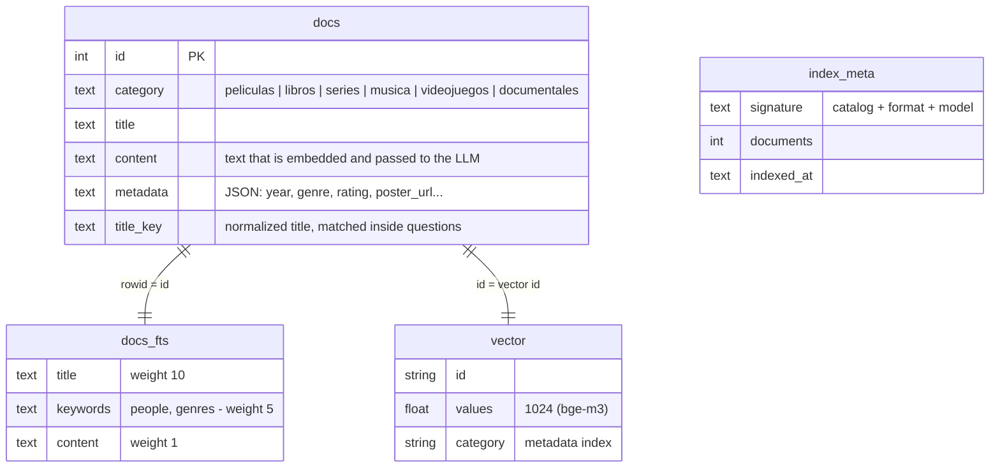

# Architecture

This document explains **how** the system works, **which parts** it is made of
and **why** each technology was chosen. Diagrams use Mermaid, which GitHub
renders natively.

The design goal is a RAG chatbot that is **always up and free to run**: no
server to maintain, no database to operate, no API key needed, and deployed
automatically from `main`.

---

## 1. Overview



Each message is turned into a vector, Vectorize finds the catalog items
closest **in meaning** while D1 finds them **by keyword and title**, and an
LLM writes the answer using only those items as context. This is the RAG
pattern (Retrieval-Augmented Generation): the LLM does not make the catalog
up, it reads it.

Everything runs on Cloudflare's network in a single Worker; static assets
(the chat UI) are served before the Worker is invoked.

### Delivery pipeline



| Workflow | Trigger | Purpose |
|---|---|---|
| `ci.yml` | every push / PR | typecheck and tests, no account needed |
| `deploy.yml` | push to `main` | test → re-index if needed → deploy → smoke test → evaluation |
| `monitor.yml` | every 6 hours | synthetic check of the live demo without spending LLM quota |

---

## 2. Indexing (build time)



`npm run index -- --if-changed` compares the signature with the one stored in
D1 (`index_meta`) and does nothing when they match, so deploys that do not
touch the catalog cost no embedding quota. Embeddings are cached per
signature in `build/`, so a failed load can be retried for free.

### What a "document" is

What gets embedded is **text describing the content**, not the file name. That
way vectors cluster by meaning (genre, theme, author...), and a question such
as *"something about surviving in the snow"* lands close to the book
*"construye un iglu"* even without shared words.

```text
[MOVIE] Algunos hombres buenos
Year: 1992
Genre: Drama
Director: Rob Reiner
Cast: Tom Cruise, Jack Nicholson, Demi Moore, ...
Synopsis: El teniente Daniel Kaffee es un joven abogado de la Marina...
Rating: 7.56/10 (4324 votes)
```

Field labels are in English, values come from the Spanish catalog. Spanish
genres get their English translation appended
(`Genre: Terror, Suspense / horror, thriller`) and English video game genres
the Spanish one (`Role-playing (RPG) / rol`), so questions in either language
match both semantically and by keyword.

### Granularity per category

Indexing the JSON as-is would let a single series or discography fill every
result, so:

| Category | Records | Documents | Strategy |
|---|---|---|---|
| Movies | 476 | 448 | 1 per title, duplicates merged (the most complete one is kept) |
| Books | 286 | 282 | 1 per book (title + author); the OCR extract is cut to 1,500 characters |
| TV series | 1,828 episodes | 17 | **1 per show**: synopsis, cast, seasons, number of episodes |
| Music | 12,943 tracks | 262 | **1 per artist/album folder** (tracks have no metadata; the path does) |
| Video games | 1,745 ROMs | 1,387 | 1 per title and platform (regional variants merged) |
| Documentaries | 32 | 27 | Same as movies |

---

## 3. Query (runtime)



### Hybrid search with Reciprocal Rank Fusion

Three candidate lists are fused in the Worker:

1. **Vector** (Vectorize, cosine): captures *meaning*, "something scary" ≈
   "Terror, Suspense".
2. **Full-text** (D1 FTS5, `bm25` weighted title > people/genre > content):
   captures *exact names*, where embeddings of short questions are imprecise.
   Documents containing *all* terms rank first. SQLite has no Spanish stemmer,
   so longer terms become prefix queries (`"pelicula"*`).
3. **Title match**: documents whose whole title appears in the question
   ("What rating does *Algunos hombres buenos* have?"), whose words would
   otherwise be dropped as Spanish stopwords.

`score = 1/(60 + vector_rank) + 1/(60 + text_rank)`, plus a bonus worth a
first place when a document contains every term of a multi-term query, and a
double bonus for a title match. No need to calibrate score scales, and a
document high in several lists rises to the top. Vector-only results below
`SIMILARITY_THRESHOLD` are dropped; keyword matches are kept.

### Conversational memory

- The browser keeps the history and sends it with each message to `/api/chat`.
- The LLM receives the last 6 messages, so it understands references ("the second one").
- For **retrieval**, a message with 3 meaningful terms or fewer is joined with the previous user question; complete new questions are searched on their own so the previous topic does not leak in.

### Category detection and language

If the question names exactly one category ("movie", "book", "play",
"songs", or their Spanish equivalents) results are filtered by it, using a
Vectorize metadata index and a D1 column. The bot answers in the language of
the question and never translates titles.

---

## 4. Technology choices

| Component | Choice | Why | Discarded alternatives |
|---|---|---|---|
| Hosting | **Cloudflare Workers** (static assets + Worker) | Free tier with 100k requests/day, no cold-start servers, global edge, UI and API in one deployable. Pages is in maintenance mode; Cloudflare recommends Workers for new projects. | VPS/containers (cost and maintenance); Vercel/Netlify functions (no integrated vector DB or free inference) |
| Language | **TypeScript** | Native runtime for Workers; the request path is I/O orchestration that fits the free plan's 10 ms CPU limit. | Python Workers (Pyodide: heavier CPU per request, little headroom at 10 ms) |
| Vector store | **Vectorize** | Managed, free tier fits the catalog (2.5 M of 5 M dimensions), metadata filtering, binding with no credentials. | pgvector (needs a PostgreSQL to run and pay for); Pinecone (external account and network hop) |
| Keyword search + documents | **D1 with FTS5** | Vectorize has no full-text search. D1 is SQLite with FTS5 and `bm25`, free, and its queries are batched in one call. | Keyword search in the Worker (CPU limit); KV (no querying) |
| Embeddings | **bge-m3** on Workers AI | Multilingual (Spanish catalog, English questions), 8k-token context, 1024 d; indexing the whole catalog costs ~10% of one day's free Neurons. | OpenAI embeddings (API key and cost); small local models (128-token context, weaker cross-language) |
| LLM | **Llama 3.3 70B** (fp8-fast) on Workers AI | Free daily allocation, good instruction following and multilingual answers. OpenAI / Anthropic can be switched on with a Worker secret. | Smaller free models (cheaper per answer, noticeably worse recommendations) |
| Abuse protection | **Workers Rate Limiting** binding | 10 questions/min per IP protects the shared free quota (and any API key). | Turnstile (friction for a demo) |
| Framework | **None** (plain Worker) | Five routes; the RAG flow (embed → search → prompt) stays explicit and testable. | Hono/itty-router (unneeded); LangChain (abstraction for four steps) |
| Tests | **Vitest + Node's built-in SQLite** | The real `schema.sql` and catalog are loaded into SQLite (which has FTS5), with Vectorize and Workers AI faked, so retrieval logic is tested without an account. The chat UI runs in happy-dom against a fake API, and CI bundles the Worker with `wrangler deploy --dry-run`. | Miniflare-only tests (no Vectorize/AI emulation); browser E2E (slower, needs a deployed demo) |
| Delivery | **GitHub Actions + wrangler** | Deploy on push, re-index only on catalog changes, evaluate the live demo, monitor every 6 h. | Manual deploys |

---

## 5. Data model



`docs` and `docs_fts` live in D1, `vector` in Vectorize. `index_meta` tells
the deploy workflow whether the loaded index matches the repository.

---

## 6. Modules

| Module | Responsibility |
|---|---|
| `src/index.ts` | Routes, input validation, rate limiting, RAG pipeline (follow-ups, category, retrieve, generate) |
| `src/retriever.ts` | Embedding, Vectorize + D1 queries in parallel, RRF fusion |
| `src/generator.ts` | Prompt assembly; Workers AI, OpenAI or Anthropic; quota handling |
| `src/text.ts` | Normalization, stopwords (Spanish + English), category detection, FTS5 queries |
| `indexer/documents.ts` | Catalog JSON → semantic documents |
| `indexer/index-catalog.ts` | Signature, embeddings, Vectorize + D1 load |
| `evaluation/` | Question battery, rubrics (`doc/rubrics.md`), evaluator against a live URL |
| `scripts/setup.ts` | Idempotent creation of D1 and Vectorize |

---

## 7. Free tier and limits

| Resource | Free allowance | This project |
|---|---|---|
| Workers requests | 100,000 / day | — |
| Worker CPU | 10 ms / request (waiting on I/O does not count) | orchestration only |
| Vectorize stored dimensions | 5 M | 2,423 × 1,024 ≈ 2.5 M |
| Vectorize queried dimensions | 30 M / month | ≈ 26,000 questions / month |
| Workers AI | 10,000 Neurons / day | indexing ≈ 1,000 (only when the catalog changes); ≈ 120 per answer → ~70 answers/day |
| D1 | 5 GB storage, 5 M rows read / day | ≈ 7 MB |

When a free allowance is exhausted the request fails with a clear message;
nothing is billed. The answer budget is the real constraint: the rate limit
keeps one visitor from using it all, and monitoring uses retrieval-only
requests that cost almost no Neurons.

---

## 8. Known limitations

- Quality depends on the JSON metadata: ~94 movies and most video games have no
  synopsis, and some series have wrong TMDB metadata (e.g. *Cosmos*), so they
  are retrieved mostly by title and genre.
- Music has no per-track genre; it is retrieved by collection, artist, album
  and track titles.
- FTS5 has no Spanish stemming; prefix queries cover plurals but not every
  inflection (the vector search covers the rest).
- ~70 free answers per day. For more, switch `LLM_PROVIDER` to OpenAI or
  Anthropic with a Worker secret.
- Re-indexing replaces the D1 tables in one load: for a few seconds during a
  catalog update, keyword search may return fewer results.
