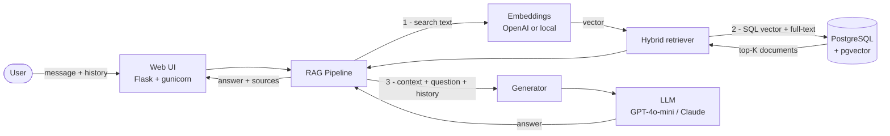
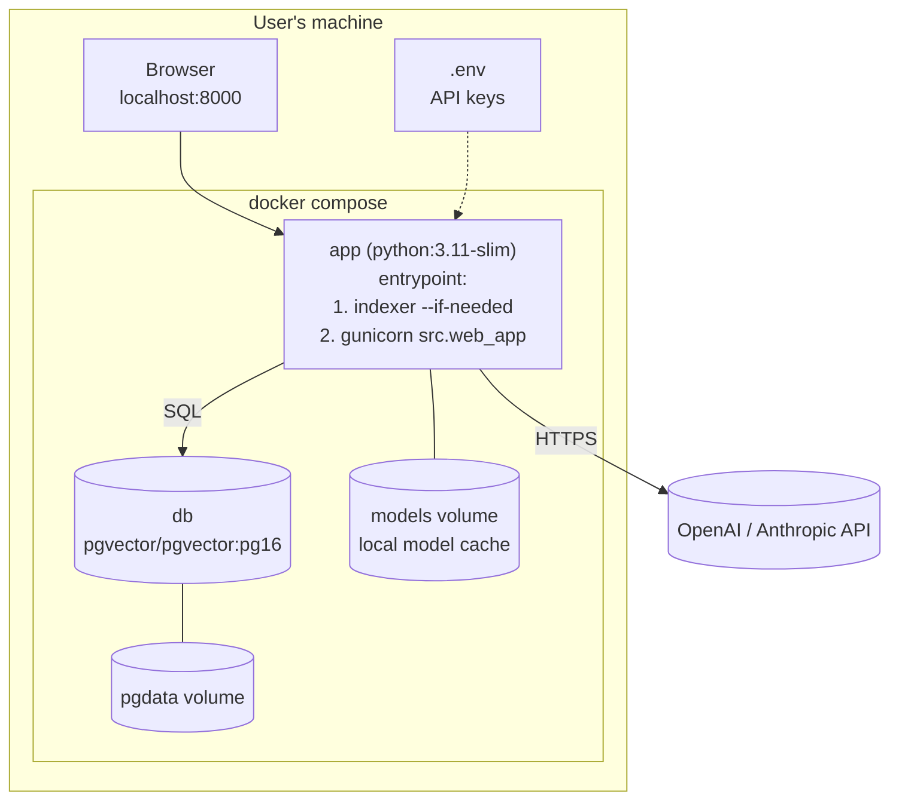
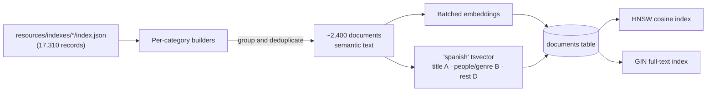
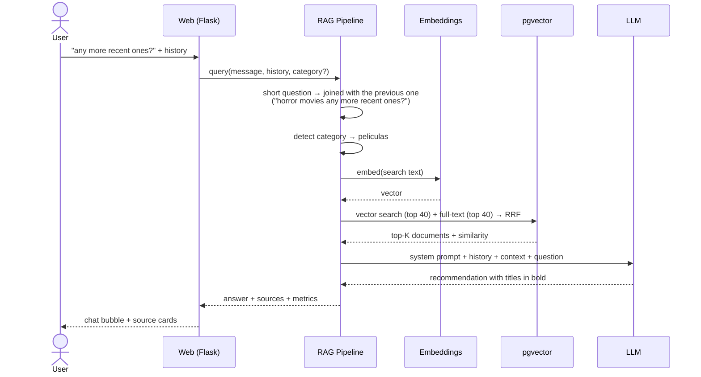
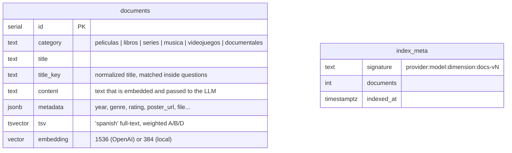

# Recommendation chatbot architecture

This document explains **how** the system works, **which parts** it is made of
and **why** each technology was chosen. Diagrams use Mermaid, which GitHub
renders natively.

---

## 1. Overview

The user chats with a web chatbot. Each message is turned into a vector
(embedding), pgvector finds the catalog items closest **in meaning** (and by
keyword), and an LLM writes the answer using only those items as context. This
is the **RAG** pattern (Retrieval-Augmented Generation): the LLM does not make
the catalog up, it reads it.



### Deployment (docker compose)



On start, the `app` container checks whether an index built with the current
embedding model and document format already exists (table `index_meta`). If
not (first start, provider change or new document version), it indexes the
catalog; then it serves the web app.

---

## 2. Indexing phase (offline)



### What a "document" is

What gets embedded is **text describing the content**, not the file name. That
way vectors cluster by meaning (genre, theme, author...), and a question such
as *"something about surviving in the snow"* lands close to the book
*"construye un iglu"* even without shared words.

```text
[MOVIE] Algunos hombres buenos
Year: 1992
Genre: Drama
Director: Rob Reiner
Cast: Tom Cruise, Jack Nicholson, Demi Moore, ...
Synopsis: El teniente Daniel Kaffee es un joven abogado de la Marina...
Rating: 7.56/10 (4324 votes)
```

Field labels are in English, while the values come from the Spanish catalog.
Spanish genres get their English translation appended
(`Genre: Terror, Suspense / horror, thriller`), and English video game genres
get the Spanish one (`Role-playing (RPG) / rol`), so questions in either
language match both semantically and by keyword.

### Granularity per category

The JSON files have very different granularity. Indexing everything as-is
would let a single series or discography fill all results, so:

| Category | Records | Documents | Strategy |
|---|---|---|---|
| Movies | 476 | ~448 | 1 per title, duplicates merged (the most complete one is kept) |
| Books | 286 | ~282 | 1 per book (title + author deduplicated); the OCR extract is cut to 1,500 characters |
| TV series | 1,828 episodes | 17 | **1 per show**: synopsis, cast, seasons and number of episodes |
| Music | 12,943 tracks | ~262 | **1 per artist/album folder** (tracks have no metadata; the path does) |
| Video games | 1,745 ROMs | ~1,387 | 1 per title and platform (regional variants merged) |
| Documentaries | 32 | ~27 | Same as movies |

---

## 3. Query phase (online)



### Hybrid search with Reciprocal Rank Fusion

A single SQL query computes two rankings and fuses them:

1. **Vector**: `ORDER BY embedding <=> query_vector` (cosine distance, HNSW
   index). Captures *meaning*: "something scary" ≈ "Terror, Suspense".
2. **Full-text**: `tsv @@ to_tsquery('spanish', 'danny | boyle')`, weighted
   (title > people/genre > synopsis), with documents containing *all* the terms
   ranked first. Captures *exact names*, where embeddings of short questions are
   not precise.
3. **RRF fusion**: `score = 1/(60 + vector_rank) + 1/(60 + text_rank)`, plus a
   bonus equal to a first place when a document contains every term of a
   multi-term query, and a double bonus when the question contains a whole
   catalog title ("What rating does *Algunos hombres buenos* have?", whose words
   would otherwise be dropped as Spanish stopwords). No need to calibrate different score scales, and a
   document ranked high in both lists rises to the top.

Results below `SIMILARITY_THRESHOLD` cosine similarity are dropped unless they
matched by keyword.

### Conversational memory

- The browser keeps the history and sends it with every message to `/api/chat`.
- The LLM receives the last `CHAT_HISTORY_MESSAGES` messages, so it understands references ("the second one you mentioned").
- For **retrieval**, a message with 3 meaningful terms or fewer is joined with the user's previous question. New, complete questions are searched on their own so the previous topic does not leak in.

### Category detection

If the question names exactly one category ("movie", "book", "play",
"songs", or their Spanish equivalents), results are filtered by it. If it names
several or none, the whole catalog is searched. The UI selector forces a
category.

### Language

The bot answers in the language of the question (English by default) and
never translates titles. Search understands both English and Spanish: stopword
and category lists cover both languages, and genres are stored bilingually.

---

## 4. Technology choices

| Component | Choice | Why | Discarded alternatives |
|---|---|---|---|
| Vector store | **PostgreSQL + pgvector** | One database for vectors, metadata (JSONB) and Spanish full-text search, all in the **same SQL query**. Official Docker image, HNSW index, no extra services. | Pinecone/Weaviate (external service or one more container, no built-in Spanish full-text); FAISS (in-memory, no persistence or SQL filters) |
| ANN index | **HNSW** | Better recall/latency than IVFFlat and can be built on the loaded table without training lists. With ~2,400 rows it is nearly exact. | IVFFlat (`lists=100` built on an empty table gives poor recall) |
| Embeddings (with OpenAI) | **text-embedding-3-small** (1536 d) | Multilingual, very good quality across English and Spanish, cheap (indexing the whole catalog costs cents). | text-embedding-3-large (more expensive, marginal gain at this size) |
| Embeddings (without OpenAI) | **fastembed + paraphrase-multilingual-MiniLM-L12-v2** (384 d) | Anthropic has no embeddings API. This model is multilingual, runs on CPU with ONNX (no PyTorch or GPU), weighs ~220 MB and is cached in a volume. It lets the system work with only an Anthropic key. | sentence-transformers + PyTorch (multi-GB image); Voyage AI (yet another key) |
| LLM | **GPT-4o-mini** or **Claude Haiku 4.5** | Fast, cheap models, good enough to write recommendations from an already filtered context. Switched with `LLM_PROVIDER`. | Larger models: more latency and cost with no noticeable gain here |
| Web | **Flask + gunicorn** | Minimal code: one page and two JSON endpoints. gunicorn serves it reliably in Docker. | FastAPI (valid, but adds nothing here); Streamlit (less control over the chat UI) |
| Front end | **Vanilla HTML + JS** | No build step or dependencies: served as a Flask template. | React/Vue (need a toolchain) |
| Orchestration | **docker compose** | `docker compose up` starts the database, indexes and serves the app: nothing to install except Docker. | Manual scripts (depend on the user's OS) |
| No RAG framework | Own code | The flow is short (embed → SQL → prompt) and stays explicit and easy to evaluate. | LangChain/LlamaIndex (abstraction layers and dependencies for 4 steps) |

---

## 5. Data model



`index_meta.signature` lets the container know whether the existing index is
compatible with the configured model and document format; if not, it
re-indexes automatically.

---

## 6. Modules

| Module | Responsibility |
|---|---|
| `src/config.py` | Reads `.env`; auto-detects LLM and embedding providers from the keys present |
| `src/text_utils.py` | Normalization (accents), meaningful query terms, category detection |
| `src/embeddings.py` | `EmbeddingService`: OpenAI or local (fastembed) backend |
| `src/indexer.py` | JSON → documents → embeddings → pgvector (+ HNSW/GIN indexes) |
| `src/retriever.py` | Hybrid vector + full-text search with RRF |
| `src/generator.py` | Recommendation prompt + OpenAI/Anthropic call with history |
| `src/rag_pipeline.py` | Orchestrates: search text, category, retrieve, generate, metrics |
| `src/web_app.py` | Chat UI, `/api/chat` (with memory) and `/api/query` (single question) |
| `tests/test_unit.py` | Fast tests without keys or database |
| `tests/test_rag_ci.py`, `tests/run_evaluation.py` | Rubric evaluation (`doc/rubrics.md`) against the real pipeline |

---

## 7. Known limitations

- Quality depends on the JSON metadata: ~94 movies and most video games have no
  synopsis, and some series have wrong TMDB metadata (e.g. *Cosmos*), so they
  are retrieved mostly by title and genre.
- Music has no per-track genre; it is retrieved by collection name, artist,
  album and track titles.
- Synopses are in Spanish. With the local model, English questions match them
  less reliably than Spanish ones (the bilingual genres help); OpenAI
  embeddings handle cross-language matching much better.
- Documents are not chunked: each catalog item is a recommendation unit and
  long texts are truncated.
- The local model only embeds the first ~128 tokens of each document (title,
  year, genre, author/director, cast and the start of the synopsis, which is
  why metadata comes first). OpenAI's limit is 8,191 tokens, so retrieval
  quality is higher: if you have both keys, use OpenAI embeddings.
